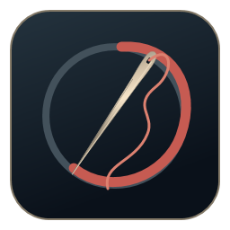
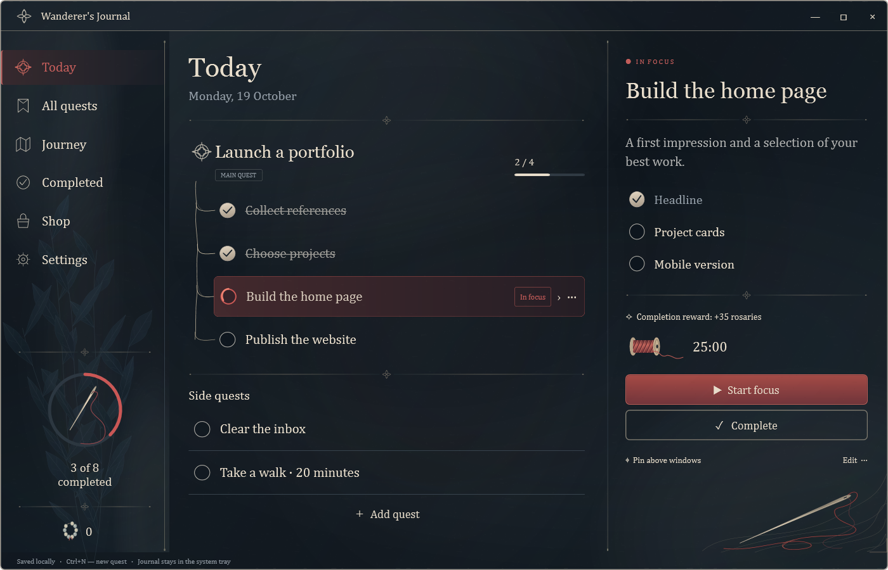
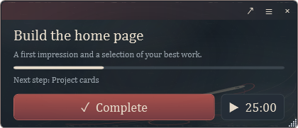
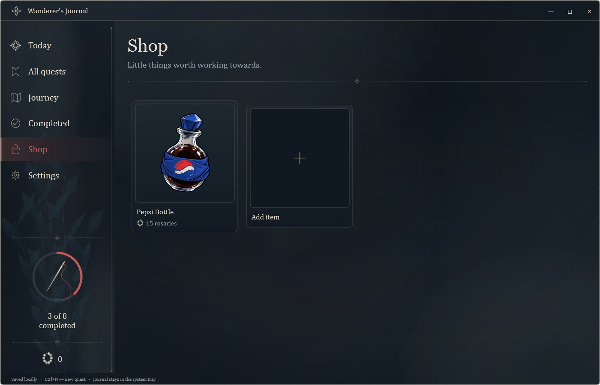
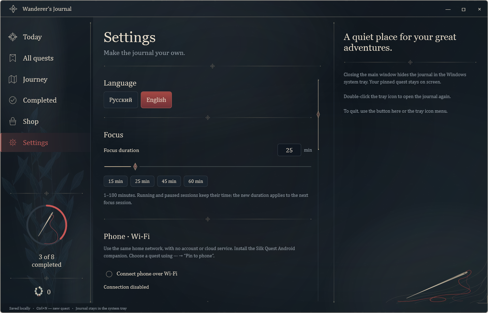
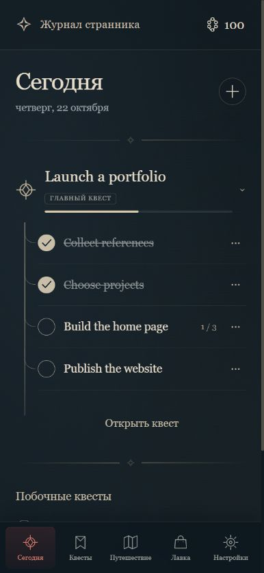

<div align="center">



# Silk Quest 2.0

### Turn real-life goals into a quest journal.

A Silksong-inspired journal for Windows and Android. Turn real-life goals into quests and earn rewards you choose.

[](https://github.com/Mach21st/Silk-Quest/releases/latest)


**[🖥️ Windows](https://github.com/Mach21st/Silk-Quest/releases/latest/download/SilkQuest-Windows-x64.zip)** · **[📱 Android APK](https://github.com/Mach21st/Silk-Quest/releases/latest/download/SilkQuest-Android.apk)** · [All releases](https://github.com/Mach21st/Silk-Quest/releases) · [Windows guide](Windows/README.md) · [Android guide](Android/README.md)

</div>



## 🧵 A quieter way to get things done

Break a large goal into small steps, follow its thread, and keep one quest in focus. Finish tasks to earn rosaries, then spend them in a shop filled with rewards you choose yourself.

No account, subscription, or cloud server. Your journal stays on your devices. Sync them directly over your home Wi-Fi.

| Follow the thread | Make room for focus |
| --- | --- |
| Nested quests, main quests and side quests, progress, and collapsible steps. | A 1–180 minute timer with a thread animation that unwinds as time passes. |
| **Keep it in sight** | **Choose your rewards** |
| A movable quest window above your other apps, with compact mode, opacity and text controls. | A personal shop with custom images, square cropping, prices, rosary purchases and purchase history. |
| **Keep your progress** | **Make it yours** |
| Ten-second undo, automatic backups, daily snapshots and export. | English and Russian UI, adjustable base rewards, motion, sound and optional weathering. |

## 🖥️ Download & start

1. Download **[SilkQuest-Windows-x64.zip](https://github.com/Mach21st/Silk-Quest/releases/latest/download/SilkQuest-Windows-x64.zip)**.
2. Extract it into a writable folder.
3. Open **SilkQuest.exe**.

**Windows 10/11 x64. No separate .NET installation required.**

The app creates a `data` folder beside the executable. Keep it when moving or updating the app. To update, quit through the tray menu, replace the executable, and leave `data` in place.

## 📌 A quest that stays with you

Choose **Pin above windows** to keep your current task in a small window while you work. Move it anywhere on the screen, resize it, or switch to a compact view.

<p align="center"></p>

Closing the main window hides it in the Windows tray; your pinned quest can stay visible. Double-click the tray icon to reopen the journal. Use the tray menu or **Settings → Quit application** to exit completely.

<details>
<summary><strong>🛍️ A personal reward shop</strong></summary>



Add a reward with the **+** card. Give it a name, description, picture and price. Drag and zoom to choose its square crop. Buying a reward deducts rosaries and records the purchase; you decide what that reward means outside the app.

Each quest pays its reward once. Main quests can also award a completion bonus. Base amounts are adjustable in Settings, and individual quests can have their own amounts.

</details>

<details>
<summary><strong>⚙️ Settings, focus & appearance</strong></summary>



Choose an exact focus duration or a 15/25/45/60-minute preset. Changing the default keeps a running or paused session intact. Adjust pinned-window opacity and text size, toggle motion and sound, or turn the weathering effect off.

</details>

## 📱 A full journal in your pocket

Android now has quests and nested steps, the reward shop, square image cropping, purchases, language settings and its own focus timer. You can work offline and keep a quest pinned in your notification shade.

<p align="center"></p>

1. Install **[SilkQuest-Android.apk](https://github.com/Mach21st/Silk-Quest/releases/latest/download/SilkQuest-Android.apk)** on Android 8 or later.
2. Update the Windows app to **2.0** and connect both devices to the same home network.
3. On Windows, enable **Settings → Phone · Wi-Fi** and show the QR code.
4. On Android, open **Settings → Connect to your PC → Scan QR**.

Quests, steps, rewards, purchases, shop pictures and the pinned quest sync in both directions. Offline edits wait on the phone and are sent when your computer is reachable. If both devices changed the same field, choose which edit to keep. Focus timers and appearance settings remain independent.

Your computer needs to be running only while exchanging changes. No account, cloud service or monthly subscription is involved. Pairing links are single-use, expire after five minutes, and pin the computer's TLS certificate.

[Android setup, backups and building from source →](Android/README.md)

## 💾 Your data

- Tasks, images, rewards and purchases are stored locally in `data/journal.json`.
- Previous saves and up to seven daily snapshots are available in **Settings → Your journal → Restore**.
- Restore brings back quests, shop items, purchases and balance together. Current phone credentials are retained.
- Public releases contain clean starter content, never a personal journal, purchase history or pairing credentials.

## 🛠️ Build from source

Build on Windows with a .NET SDK supporting .NET 8/WPF:

```powershell
dotnet publish Windows/SilkJournal.csproj -c Release -r win-x64 --self-contained true -p:PublishSingleFile=true -p:IncludeNativeLibrariesForSelfExtract=true -p:DebugType=None -o publish
```

Run `publish/SilkJournal.exe`, or rename it to `SilkQuest.exe`. The starter art and translations are embedded. Android build instructions are in [Android/README.md](Android/README.md).

| Path | Contents |
| --- | --- |
| `Windows/` | WPF app, starter content, local HTTPS bridge and tests |
| `Android/` | Companion, QR scanner, notification actions and offline queue |
| `docs/images/` | Screenshots of the English app |

### Verification

Use `--self-test`, `--verify-ui`, or `--verify-phone` on a test copy. The checks use separate data and cover saving and recovery, rewards, purchases, timer settings, preview-window lifecycle, localization, and real localhost HTTPS pairing and retry behavior. The phone test uses port 38929.

## 💬 Feedback

Found a bug or have a small improvement in mind? [Open an issue](https://github.com/Mach21st/Silk-Quest/issues/new) with what happened, what you expected, and a screenshot if it helps.

---

Made by [Mach21st](https://github.com/Mach21st). An independent fan-inspired productivity app, not affiliated with Team Cherry. Third-party notices are included in `Windows/Licenses` and `Android/assets`.
